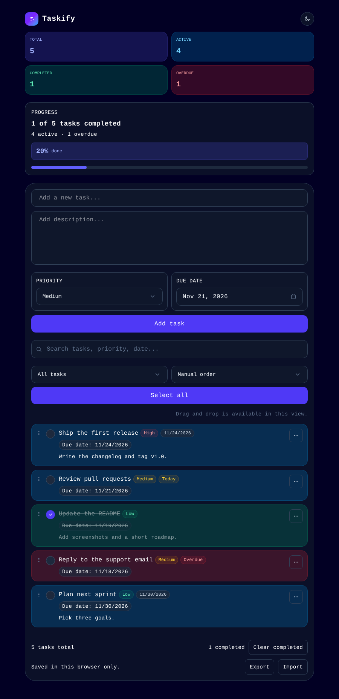

# Taskify

A clean, local-first task manager built with React and Tailwind CSS.
No account, no server, no tracking: your tasks stay in your browser.



## Features

- Add, edit and delete tasks
- Priorities (low, medium, high) and due dates
- Overdue detection
- Drag and drop reordering
- Filter (all, active, completed), sort (manual, newest, oldest, priority, due date)
- Live search
- Select all, clear completed
- Dark and light mode
- Export and import of your tasks as a JSON backup
- Responsive, mobile-first layout

## Tech stack

- React 19 and Vite
- Tailwind CSS 4

## Getting started

You need Node.js 20 or newer.

```bash
git clone https://github.com/eljakj/taskify.git
cd taskify
npm install
npm run dev
```

Open http://localhost:5173.

Other commands:

```bash
npm run build     # production build in dist/
npm run preview   # serve the production build locally
npm run lint      # ESLint
```

## Where your data lives

Tasks are stored in the browser's `localStorage` under the key
`taskify.todos.v1`. This means:

- Data stays on the device and browser you used. Other devices do not see it.
- Clearing site data deletes your tasks. Use **Export** to save a backup file
  and **Import** to restore it (import replaces the current list).
- If the browser blocks `localStorage` (for example in some private modes),
  Taskify shows a notice and keeps your tasks in memory until you reload.

### Using a different backend

All storage code is in [`src/services/todoApi.js`](src/services/todoApi.js).
The UI only calls these async functions:

`getTodos`, `createTodo`, `updateTodo`, `reorderTodos`,
`setAllTodosCompleted`, `removeTodo`, `clearCompleted`

Replace the bodies with calls to a REST API, Supabase, IndexedDB or anything
else and keep the return values the same. A task looks like this:

```json
{
  "id": "string",
  "title": "string",
  "description": "string",
  "completed": false,
  "priority": "low | medium | high",
  "dueDate": "YYYY-MM-DD or empty string",
  "order": 0,
  "createdAt": "ISO timestamp"
}
```

## Deployment

Taskify is a static site. Build it and upload the `dist/` folder to any static
host (Vercel, Netlify, GitHub Pages, Cloudflare Pages, ...).

- Build command: `npm run build`
- Output directory: `dist`

No environment variables are needed.

## Project structure

```
taskify/
├── public/            favicon
├── screenshots/
├── src/
│   ├── components/    UI components
│   ├── hooks/         useTheme
│   ├── services/      todoApi.js (storage layer)
│   ├── utils/         date helpers
│   ├── App.jsx
│   ├── index.css
│   └── main.jsx
└── index.html
```

## Author

Jad El Jakhlab, https://github.com/eljakj

## License

MIT, see [LICENSE](LICENSE).
